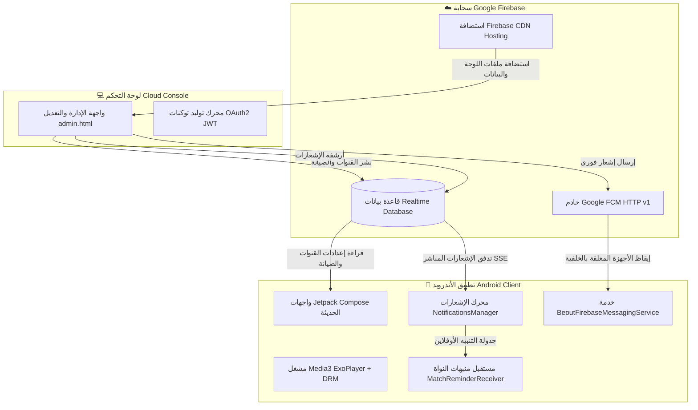
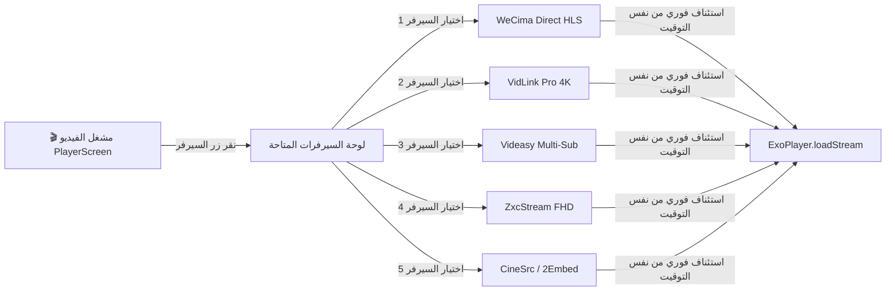

# المرجع الهندسي الشامل والنهائي لمنظومة BeoutTV 📱⚽🌐
**وثيقة المعمارية التشغيلية المعتمدة والتحديثات البرمجية الكاملة**

---

## 📑 فهرس المحتويات
1. [المعمارية الشاملة لمنظومة BeoutTV](#1-المعمارية-الشاملة-لمنظومة-beouttv)
2. [هوية التطبيق البصرية ونظام حظر الإيموجي](#2-هوية-التطبيق-البصرية-ونظام-حظر-الإيموجي)
3. [المرجع الهندسي المتكامل لنظام الإشعارات](#3-المرجع-الهندسي-المتكامل-لنظام-الإشعارات)
4. [لوحة التحكم السحابية (Cloud Console) وشجرة الأقسام](#4-لوحة-التحكم-السحابية-cloud-console-وشجرة-الأقسام)
5. [مرجع سيرفرات Google Firebase والمفاتيح وقواعد البيانات](#5-مرجع-سيرفرات-google-firebase-والمفاتيح-وقواعد-البيانات)
6. [محرك المباريات وترتيب الدوريات المعتمد](#6-محرك-المباريات-وترتيب-الدوريات-المعتمد)
7. [دليل أوامر الصيانة والتحديث والنشر والتشغيل](#7-دليل-أوامر-الصيانة-والتحديث-والنشر-والتشغيل)

---

## 1. المعمارية الشاملة لمنظومة BeoutTV

تتكون منظومة **BeoutTV** من ثلاثة أركان رئيسية مترابطة بشكل متكامل وسريع:



---

## 2. هوية التطبيق البصرية ونظام حظر الإيموجي

### أ) نظام الألوان (Matte Obsidian Enterprise Palette):
- **الخلفية الأساسية (`BeoutColors.Background`):** `#0A0E14` (أسود فحمي مطفي يمنع إجهاد العين ويوفر بطاريات شاشات OLED).
- **بطاقات المحتوى (`BeoutColors.Card`):** `#101721` و `#151F2C` (رمادي داكن متدرج).
- **الحدود والفواصل (`BeoutColors.Divider`):** `#202E3F` و `#2D3F56` (حدود هندسية ناعمة تعطي عمقاً 3D خفيفاً).
- **اللون المميز الأساسي (`BeoutColors.BrightBlue`):** `#2F81F7` و `#58A6FF` (أزرق كهربائي ملكي).
- **أحمر البث الحي والمخاطر (`BeoutColors.Live`):** `#E53935` (شارات المباشر، العدادات، وزر مسح الكل).
- **أخضر النجاح والحالة (`BeoutColors.Success`):** `#238636` / `#3FB950` (استثناء البطارية ومطابقة السيرفر).

### ب) شجرة التدرج الطباعي والخطوط (Cairo Typography Scale):
- **الخط الأساسي:** `Cairo` (خط عربي حديث وهندسي بدعم كامل لاتجاه اليمين لليسار RTL).
- **`ScreenTitle`:** 18sp • ExtraBold (عناوين الشاشات الرئيسية).
- **`SectionTitle`:** 15sp • Bold (عناوين الفئات والأقسام).
- **`CardTitle`:** 13.5sp • SemiBold (أسماء الفرق، القنوات، والأفلام).
- **`SecondaryInfo`:** 12sp • Medium (وقت المباراة، المعلق، والقناة).
- **`Caption`:** 10.5sp - 11sp • Regular (شارات الجولات والتبويبات).

### ج) معمارية حظر الإيموجي واستبدالها بالـ Vector Icons:
> [!IMPORTANT]
> **لماذا تم حظر الإيموجي بالكامل في التطبيق؟**
> 1. اختلاف وتشتت شكل الإيموجي بين أنظمة أندرويد المختلفة (سامسونج، شاومي، هواوي، جوجل).
> 2. تسبب محارف الإيموجي قفزات في محاذاة أسطر النصوص (Line-Height jumps) في محرك Compose.
> 3. الحفاظ على الهوية الفاخرة الموحدة.

#### جدول استبدال الأيقونات الرسمي:
| الرمز الممنوع | أيقونة Vector البديلة المعتمدة | الاستخدام في الواجهة |
| :---: | :--- | :--- |
| `⚽` | `Icons.Rounded.SportsSoccer` | تذكيرات المباريات وشريط المباريات |
| `📢` | `Icons.Rounded.Campaign` | إعلانات البث المباشر والإشعارات الإدارية |
| `🔔` | `Icons.Rounded.NotificationsActive` | جرس التنبيهات وإذن الإشعارات |
| `🏆` | `Icons.Rounded.EmojiEvents` | شعار البطولة والمسابقات |
| `🗑️` | `Icons.Rounded.DeleteOutline` | زر مسح الكل وحذف الإشعار |
| `⚡` | `Icons.Rounded.ElectricBolt` / `BatteryChargingFull` | إذن استثناء توفير البطارية |
| `📋` | `Icons.Rounded.ListAlt` | تبويب عرض جميع الإشعارات |

---

## 3. المرجع الهندسي المتكامل لنظام الإشعارات

تم بناء منظومة الإشعارات وفق **معمارية خماسية الطبقات (5-Layer Notification Engine)** تضمن وصول الإشعار في كل الظروف:

```
┌────────────────────────────────────────────────────────────────────────┐
│                      منظومة الإشعارات الشاملة                         │
├────────────────────────────────────────────────────────────────────────┤
│ 1. طبقة Google FCM HTTP v1 Data-Only: إيقاظ الأجهزة المغلقة عبر السيرفر │
│ 2. طبقة Realtime SSE Socket Stream: البث الفوري أثناء التواجد بالتطبيق  │
│ 3. طبقة Exact AlarmManager Kernel: منبهات المباريات الدقيقة (أوفلاين)    │
│ 4. طبقة Background Polling Receiver: مزامنة دورية للأجهزة بدون خدمات GMS│
│ 5. طبقة Server History Sync: أرشفة ومزامنة جميع الإشعارات السابقة      │
└────────────────────────────────────────────────────────────────────────┘
```

### 1. طبقة البث الفوري السحابي (FCM HTTP v1 Data-Only):
- **كيفية العمل:** عند الضغط على إرسال إشعار من اللوحة، يتم إرسال رسالة **Data-Only** (أي بدون كائن `notification` التقليدي).
- **الميزة الحيوية:** رسائل الـ Data-Only تجبر نظام أندرويد على تشغيل كود [`BeoutFirebaseMessagingService`](file:///storage/emulated/0/CodeOnTheGoProjects/Beouttv/app/src/main/java/com/beouttv/app/data/notification/BeoutFirebaseMessagingService.kt) فوراً في الخلفية، مما يحقق:
  - إطلاق إشعار النظام المخصص فوراً بصوت واهتزاز.
  - تسجيل الإشعار مباشرة في الذاكرة الدائمة (`saved_notification_items`).
  - تحديث معرّف الإشعار الأخير (`last_seen_id`) حتى **لا يتكرر الإشعار إطلاقاً عند فتح التطبيق لاحقاً**.

### 2. طبقة منبهات المباريات الأوفلاين (Exact Offline Match Reminders):
- **الملف المسؤول:** [`MatchReminderReceiver.kt`](file:///storage/emulated/0/CodeOnTheGoProjects/Beouttv/app/src/main/java/com/beouttv/app/data/notification/MatchReminderReceiver.kt)
- **الآلية:** يتم جدولة المنبه بنواة النظام عبر `AlarmManager.setExactAndAllowWhileIdle` مع `RTC_WAKEUP`.
- **التوقيت المخصص:** يقرأ وقت التنبيه من إعدادات المستخدم (`0` دقيقة عند البداية، `15`، `30`، أو `60` دقيقة قبل المباراة).
- **حماية إعادة التشغيل:** مسجل لاستقبال إشارة `BOOT_COMPLETED` لإعادة جدولة المنبهات تلقائياً عند إعادة تشغيل الهاتف.

### 3. طبقة أرشفة ومزامنة السجل السحابي (Server History Sync):
- عند إرسال أي إشعار من اللوحة، يتم حفظه في مسارين بقاعدة البيانات:
  - المسار النشط: `/notifications/broadcast.json`
  - الأرشيف الدائم: `/notifications/history/{notif_id}.json`
- عند تشغيل التطبيق، تقوم دالة `syncServerBroadcastHistory` بمزامنة كافة الإشعارات التاريخية ودمجها مع تنبيهات المباريات وعرضها في شاشة الإشعارات مرتبة تنازلياً.

### 4. استثناء قيود البطارية لأجهزة Tecno و شاومي وسامسونج:
- **الملف:** [`BatteryOptimizationHelper.kt`](file:///storage/emulated/0/CodeOnTheGoProjects/Beouttv/app/src/main/java/com/beouttv/app/data/notification/BatteryOptimizationHelper.kt)
- يطلب إذن النظام الرسمي `REQUEST_IGNORE_BATTERY_OPTIMIZATIONS`.
- يحتوي على تحويلات مخصصة لمدير الهاتف في أجهزة **Tecno (HiOS Phone Master Auto-start)** وشاومي (MIUI/HyperOS) وهواوي وسامسونج.

---

## 4. لوحة التحكم السحابية (Cloud Console) وشجرة الأقسام

- **رابط الدخول المباشر:**
  👉 **`https://digite-bda04.web.app/admin.html`**

### منظومة الحماية والتشفير السحابي المعتمدة (Enterprise AES-256-GCM Vault):
- **حماية الدخول:** اللوحة مغلقة بالكامل خلف بوابة مصادقة مشفرة تمنع عرض القنوات أو استدعاء أي عمليات إدارية دون إدخال رمز الدخول السحابي المعتمد.
- **تشفير المفتاح الخاص:** تم تشفير مفتاح Google Service Account Private Key باستخدام خوارزمية **AES-256-GCM** مع اشتقاق مفاتيح **PBKDF2-HMAC-SHA256 (100,000 جولة)** ولا يظهر في السورس كود بشكل مكشوف.
- **رموز الدخول المعتمدة للمسؤول:**
  1. **رمز المرور الرئيسي الفائق (Master Passcode):** `BeoutAdmin@2026`
  2. **رمز PIN الرقمي السريع (Quick PIN):** `984220`
- **الحماية ضد هجمات التخمين (Anti-Brute-Force):** إغلاق مؤقت وتجميد الإدخال لمدة 60 ثانية بعد 5 محاولات خاطئة.
- **القفل التلقائي للخمول (Auto-Lock):** قفل اللوحة ومسح مفاتيح الجلسة من ذاكرة المتصفح تلقائياً بعد 30 دقيقة خمول.
- **زر تسجيل الخروج:** متاح دائماً في الشريط العلوي لمسح الجلسة فوراً.

### شجرة هيكل عناصر لوحة التحكم (Component Tree):

```
BeoutTV Cloud Console (admin.html)
├── 🔐 AES-256-GCM Decryption Gate (بوابة الدخول وفك التشفير)
│   ├── حقل إدخال رمز المرور أو PIN مع زر إظهار/إخفاء
│   ├── خيار تذكر الجلسة المشفرة
│   └── نظام حماية التخمين الآلي ومؤقت الإغلاق
│
├── 🌐 Top Header Bar (شريط الرأس العلوي)
│   ├── Logo & System Title (شعار BeoutTV)
│   ├── شارة حالة التشفير والمصادقة (المشرف معتمد / مقفل)
│   ├── زر تسجيل الخروج الفوري
│   └── Quick Status Shortcuts (البطاقات السريعة المختصرة)
│       ├── 📺 إجمالي القنوات المسجلة
│       ├── 🛡️ حالة بوابة التطبيق (طبيعي / صيانة)
│       ├── 🔔 زر اختصار إرسال الإشعار
│       └── 🔒 حالة الأمان والتشفير
│
├── 📑 Main Navigation Tabs (شريط التبويبات الرئيسي)
│   │
│   ├── 📺 [التبويب 1: إدارة القنوات والبث]
│   │   ├── قائمة القنوات الحالية (مع أزرار التعديل والحذف والفحص)
│   │   ├── نافذة إضافة / تعديل قناة (Modal Editor)
│   │   │   ├── اسم القناة وتصنيفها وشعارها
│   │   │   ├── رابط البث المباشر (HLS / DASH)
│   │   │   ├── رؤوس الحماية (User-Agent, Referer, Cookie)
│   │   │   └── مفاتيح ClearKey DRM و Widevine License
│   │   └── 🎬 مشغل الفحص المدمج (Live Player Preview - HLS.js)
│   │
│   ├── 🛡️ [التبويب 2: بوابة التطبيق والصيانة]
│   │   ├── محدد وضع التطبيق (NORMAL / MAINTENANCE / UPDATE_REQUIRED)
│   │   ├── نص رسالة الصيانة المعروضة للمستخدمين
│   │   ├── رابط تحميل التحديث الإجباري (APK Download URL)
│   │   └── زر حفظ ونشر الإعدادات السحابية فوراً
│   │
│   ├── 🔔 [التبويب 3: مركز الإشعارات الفورية السحابي]
│   │   ├── حقل عنوان الإشعار
│   │   ├── حقل نص الرسالة وتفاصيل البث
│   │   ├── زر الإرسال الفوري (FCM v1 + Realtime DB)
│   │   └── 📜 بطاقة عرض آخر إشعار مبثوث وتاريخ إرساله
│   │
│   └── 🔒 [التبويب 4: إدارة الأمان ورمز الدخول]
│       ├── مراقبة الجلسة وحالة التشفير
│       ├── أداة تعيين وتشفير رمز مرور أو PIN جديد
│       └── معايير الأمان المطبقة
│
└── 🔐 In-Memory OAuth2 JWT Signing Engine (محرك توكنات FCM المشفر)
    └── RSA-SHA256 Private Key Signer (jsrsasign) يتم فكه في الذاكرة المؤقتة فقط
```

---


## 5. مرجع سيرفرات Google Firebase والمفاتيح وقواعد البيانات

### بيانات المشروع السحابي (Firebase Project Metadata):
| المعامل | القيمة المعتمدة |
| :--- | :--- |
| **Project ID** | `digite-bda04` |
| **Project Number** | `321331481126` |
| **Hosting Domain** | `https://digite-bda04.web.app` |
| **Realtime Database** | `https://digite-bda04-default-rtdb.firebaseio.com` |
| **Service Account** | `firebase-adminsdk-lpwzc@digite-bda04.iam.gserviceaccount.com` |
| **Service Account File** | `digite-bda04-firebase-adminsdk-lpwzc-ebd442be66.json` |

### خريطة مسارات قاعدة البيانات Realtime Database:
```json
{
  "gateway": {
    "status": "NORMAL",
    "maintenanceMessage": "التطبيق في وضع الصيانة المجدولة...",
    "updateUrl": "https://digite-bda04.web.app/beouttv-latest.apk"
  },
  "channels": [
    {
      "id": "ch_bein1",
      "name": "beIN Sports HD 1",
      "category": "beIN Sports",
      "streamUrl": "https://.../stream.m3u8",
      "logoUrl": "https://..."
    }
  ],
  "notifications": {
    "broadcast": {
      "id": "notif_1725050000000",
      "title": "قمة الدوري الإنجليزي",
      "message": "انطلاق مباراة مانشستر سيتي ضد ليفربول الآن!",
      "timestamp": "2026-08-30T20:00:00Z",
      "enabled": true
    },
    "history": {
      "notif_1725050000000": { ... },
      "notif_1725040000000": { ... }
    }
  }
}
```

---

## 6. محرك المباريات وترتيب الدوريات المعتمد

### ترتيب أولويات الدوريات (Top Leagues Priority Order):
تم توحيد ترتيب الدوريات في شريط الفئات العلوي وفي قائمة المباريات اليومية (`groupedMatches`) كالتالي:
1. 🏴󠁧󠁢󠁥󠁮󠁧󠁿 **الدوري الإنجليزي الممتاز (Premier League)** — أولاً في الصدارة
2. 🇪🇸 **الدوري الإسباني (La Liga)** — ثانياً
3. 🇮🇹 **الدوري الإيطالي (Serie A)** — ثالثاً
4. 🇩🇪 **الدوري الألماني (Bundesliga)** — رابعاً
5. 🇫🇷 **الدوري الفرنسي (Ligue 1)** — خامساً
6. 🇮🇶 **دوري نجوم العراق (Iraq Stars League)** — سادساً
7. 🏆 **دوري أبطال أوروبا (UEFA Champions League)** — سابعاً
8. 🇸🇦 **دوري روشن السعودي**
9. 🇪🇬 **الدوري المصري الممتاز**
10. 🇦🇪 **دوري أدنوك الإماراتي**
... وبقية البطولات العربية والعالمية.

---

## 7. دليل أوامر الصيانة والتحديث والنشر والتشغيل

### 1. مزامنة جدول المباريات وتوليد ملفات Protobuf و JSON:
```bash
node /storage/emulated/0/CodeOnTheGoProjects/Beouttv/scripts/sync_matches.js
```

### 2. رفع ونشر التحديثات على استضافة Google Firebase:
```bash
node /storage/emulated/0/CodeOnTheGoProjects/Beouttv/scripts/deploy_firebase.js
```

### 3. إرسال إشعار فوري من سطر الأوامر (Terminal FCM v1 Push):
```bash
node -e "
const fs = require('fs'), crypto = require('crypto');
const sa = JSON.parse(fs.readFileSync('/storage/emulated/0/CodeOnTheGoProjects/Beouttv/digite-bda04-firebase-adminsdk-lpwzc-ebd442be66.json', 'utf8'));
const now = Math.floor(Date.now() / 1000);
const header = { alg: 'RS256', typ: 'JWT' };
const payload = { iss: sa.client_email, sub: sa.client_email, aud: 'https://oauth2.googleapis.com/token', iat: now, exp: now + 3600, scope: 'https://www.googleapis.com/auth/firebase.messaging' };
const enc = o => Buffer.from(JSON.stringify(o)).toString('base64url');
const unsigned = enc(header) + '.' + enc(payload);
const s = crypto.createSign('RSA-SHA256'); s.update(unsigned);
const sig = s.sign(sa.private_key, 'base64url');
fetch('https://oauth2.googleapis.com/token', { method: 'POST', headers: {'Content-Type':'application/x-www-form-urlencoded'}, body: new URLSearchParams({grant_type:'urn:ietf:params:oauth:grant-type:jwt-bearer', assertion: unsigned + '.' + sig}) })
.then(r => r.json()).then(t => {
  fetch('https://fcm.googleapis.com/v1/projects/digite-bda04/messages:send', { method: 'POST', headers: {'Content-Type':'application/json', 'Authorization':'Bearer ' + t.access_token}, body: JSON.stringify({message: {topic:'all_users', data: {id: 'cli_' + Date.now(), title: 'تنبيه مباشر', message: 'بث مباراة الليلة متاح الآن بدقة عالية'}, android: {priority:'HIGH'}}}) })
  .then(r => r.json()).then(console.log);
});
"
```

### 4. إعادة تفعيل قاعدة بيانات Firebase (في حال ظهور خطأ 423 Deactivated):
```bash
node -e "
const fs = require('fs'), crypto = require('crypto');
const sa = JSON.parse(fs.readFileSync('/storage/emulated/0/CodeOnTheGoProjects/Beouttv/digite-bda04-firebase-adminsdk-lpwzc-ebd442be66.json', 'utf8'));
const now = Math.floor(Date.now() / 1000);
const header = { alg: 'RS256', typ: 'JWT' };
const payload = { iss: sa.client_email, sub: sa.client_email, aud: 'https://oauth2.googleapis.com/token', iat: now, exp: now + 3600, scope: 'https://www.googleapis.com/auth/firebase.database https://www.googleapis.com/auth/cloud-platform' };
const enc = o => Buffer.from(JSON.stringify(o)).toString('base64url');
const unsigned = enc(header) + '.' + enc(payload);
const s = crypto.createSign('RSA-SHA256'); s.update(unsigned);
const sig = s.sign(sa.private_key, 'base64url');
fetch('https://oauth2.googleapis.com/token', { method: 'POST', headers: {'Content-Type':'application/x-www-form-urlencoded'}, body: new URLSearchParams({grant_type:'urn:ietf:params:oauth:grant-type:jwt-bearer', assertion: unsigned + '.' + sig}) })
.then(r => r.json()).then(t => {
  fetch('https://firebasedatabase.googleapis.com/v1beta/projects/321331481126/locations/us-central1/instances/digite-bda04-default-rtdb:reenable', { method: 'POST', headers: {'Authorization': 'Bearer ' + t.access_token} })
  .then(r => r.json()).then(console.log);
});
"
```

### 5. تنظيف أقفال Gradle في حال ظهور تعارض Lock Files:
```bash
python3 -c "import os, glob; [os.remove(f) for f in glob.glob('/storage/emulated/0/CodeOnTheGoProjects/Beouttv/.gradle/**/*.lock', recursive=True)]"
```

---

## 8. معمارية منظومة السينما، المسلسلات، والمشغل المتطور (Cinema & Series Engine)

### أ) آلية التبديل بين السيرفرات من داخل المشغل (In-Player Server Switcher):
1. **الظهور التلقائي:** عند توفر أكثر من سيرفر بث للفيلم أو الحلقة، يظهر زر **"السيرفر" (Server)** في الشريط السفلي لعناصر تحكم المشغل بجانب زر "الترجمة والصوت" و "الجودة".
2. **نافذة السيرفرات الزجاجية (Glass Modal):** عند النقر على زر "السيرفر"، تنبثق لوحة سفلية (`PlayerSheetType.SERVERS`) تعرض جميع السيرفرات المتاحة مع جودة كل سيرفر ونوعه (بث مباشر أصلي vs سيرفر سحابي بديل).
3. **التبديل الفوري والذكي:** عند اختيار أي سيرفر، يقوم المشغل فوراً بالتبديل إلى السيرفر المختار واستئناف التشغيل من نفس الثانية الدقيقة (`currentPosition`) التي كان يقف عندها المشاهد، دون الحاجة للخروج من المشغل أو إعادة التحميل من البداية.
4. **زر التبديل عند الخطأ:** في حال انقطاع البث أو بطء السيرفر، يظهر زر مباشر **"تغيير السيرفر"** في نافذة الخطأ للتنقل السريع بين السيرفرات.



### ب) معمارية السيرفرات الخمسة المعتمدة (5-Tier Multi-Source Streams):
1. **سيرفر WeCima الرئيسي (Direct HLS):** `https://govid.live/prem-{realid}.m3u8`
2. **سيرفر VidLink Pro (4K Ultra HD):** يعتمد على TMDB ID للبث فائق الجودة والسرعة.
3. **سيرفر Videasy Multi-Sub:** يدعم تعدد الترجمات والمسارات الصوتية.
4. **سيرفر ZxcStream FHD:** مخصص للاتصالات المتوسطة والضعيفة.
5. **سيرفر CineSrc / 2Embed:** السيرفر الاحتياطي الدائم.

### ج) محرك الترجمة الحقيقي المباشر (Multi-Source Subtitle Engine):
* يجلب الترجمات تلقائياً من **SubDL + OpenSubtitles + Wyzie**.
* يحقن ملفات الترجمة مباشرة في `MediaItem.SubtitleConfiguration`.
* قائمة "الترجمة والصوت" في المشغل تعرض جميع ملفات الترجمة الحقيقية المتوفرة (العربية، الإنجليزية، إلخ) مع إمكانية الإيقاف أو التفعيل الفوري.

### د) معمارية المسلسلات وقائمة المواسم المنسدلة (Series & Seasons Dropdown):
* **جلب ديناميكي متعدد الأقسام:** مسلسلات عربية، أجنبية، تركية، آسيوية، وإنيمي.
* **جلب المواسم:** عبر نقطة نهاية `action=seasons&series_slug=...`.
* **جلب الحلقات:** عبر نقطة نهاية `action=posts&season_slug=...&page=1&per_page=100`.
* **واجهة المواسم المنسدلة:** صندوق أنيق منبثق (`androidx.compose.material3.DropdownMenu`) باللون الداكن الفاخر `#161F2C` يعرض أسماء المواسم وعدد حلقاتها ويقوم بتحديث شبكة الحلقات بسلاسة تامة.

---

## 9. منظومة تعدد مصادر المحتوى والتصفح اللامحدود وتطابق بيانات IMDb

### أ) محرك إدارة مصادر المحتوى (`MediaSourceManager`):
1. **تعدد المصادر الرسمية والسحابية:**
   * **سيرفر WeCima الرئيسي:** `https://wecima.bar/api.php`
   * **سيرفر WeCima البديل (Mirror):** `https://wecima.show/api.php`
   * **سيرفر ماي سيما (MyCima API):** `https://mycima.bar/api.php`
   * **سيرفر سينما برو (Cinema Pro Gateway):** `https://atared.serv00.net/stream-panel/api.php`
   * **سيرفر Cloudflare Proxy:** `https://oneplus-proxy.bountyify.workers.dev/api.php`
2. **إضافة مصادر مخصصة (Custom Sources):** إمكانية إدخال أي رابط API خارجي وتسميته وحفظه في الذاكرة الدائمة وتفعيله فورياً.
3. **التبديل الفوري والتحديث التفاعلي الشامل:**
   * عند تغيير المصدر، يطلق `MediaSourceManager` حدث تدفق تفاعلي (`sourceSwitchEvent`).
   * يقوم المستودع (`RemoteMediaRepository`) بمسح الكاش فوراً وإعادة الجلب من المصدر الجديد.
   * يتم تحديث **الشاشة الرئيسية بالكامل** (البانر المميز، أحدث السينما، المسلسلات الحصرية) بالإضافة إلى شاشات الأفلام والمسلسلات دون الحاجة لإعادة تشغيل التطبيق.

### ب) معمارية التصفح اللامحدود والترقيم اللانهائي (Infinite Scroll Pagination):
1. دعم التمرير اللانهائي في شاشات الأفلام والمسلسلات (`LazyVerticalGrid`).
2. جلب الصفحات اللاحقة تلقائياً (`page = 1, 2, 3, 4...`) فور اقتراب المشاهد من نهاية القائمة.
3. استخراج كافة التصنيفات الحقيقية ديناميكياً من المصدر النشط (`action=categories`) وتوزيعها تلقائياً بين تبويبات الأفلام والمسلسلات.

### ج) معمارية حماية تطابق القصص والبوسترات ومنع التضارب (`ImdbMetadataEngine`):
1. **قاعدة قدسية بيانات المصدر (Source Truth Guarantee):**
   * القصة الأصلية المكتوبة في المصدر (`meta.story`) هي المرجع الحقيقي للبث، ولا يتم استبدالها إطلاقاً بقصة فيلم أجنبي أو غير متطابق.
   * البوستر الأصلي المرفوع مع البث يتم الحفاظ عليه لضمان تطابق ما يشاهده المستخدم مع ما يتم تشغيله.
2. **مطابقة سنة الإنتاج الصارمة (Strict Release Year Verification):**
   * يتم فحص نتائج IMDb ومقارنة سنة الإنتاج `item.y` بسنة العمل بالمصدر `movie.year` بهامش خطأ لا يتجاوز سنة واحدة (`±1`).
   * في حال وجود تشابه بالاسم مع عمل من سنة مختلفة (مثل فيلم 2026 وفيلم 1999 يحملان نفس الاسم)، يتم رفض المطابقة وحماية بيانات العمل الأصلي فوراً.
3. **مطابقة النجوم والممثلين (Cast Matching):** التحقق من وجود أبطال العمل لتأكيد دقة معرّف IMDb بنسبة 100%.

---

## 10. بيئة البناء وتحديث منصة CoGo المعتمدة (Modern Build Stack)

تم ترقية وتوافق بيئة البناء بالكامل لتتطابق مع أحدث بيئة تشغيل لمنصة **Code on the Go (CoGo™)**:
* **Gradle Version:** `9.6.1` عبر [`gradle-wrapper.properties`](file:///storage/emulated/0/CodeOnTheGoProjects/Beouttv/gradle/wrapper/gradle-wrapper.properties)
* **Android Gradle Plugin (AGP):** `9.3.1` عبر [`build.gradle.kts`](file:///storage/emulated/0/CodeOnTheGoProjects/Beouttv/build.gradle.kts)
* **Kotlin Language & Toolchain:** `2.3.21` مع إضافة ملحق `org.jetbrains.kotlin.plugin.compose`
* **إلغاء المعلمات المتقادمة:** حذف `kotlinCompilerExtensionVersion` وتهيئة خيارات المترجم الحديثة عبر `compilerOptions { jvmTarget.set(JvmTarget.JVM_17) }`
* **تنظيف التبعيات:** إزالة قيود `force` على إصدارات stdlib 1.9 القديمة لضمان توافق الحزم ومحاذاة التجميع على أجهزة 64-bit.

---
*تم إعداد وتحديث هذا المرجع الشامل ليكون الدليل الهندسي الدائم لمنظومة BeoutTV.*


