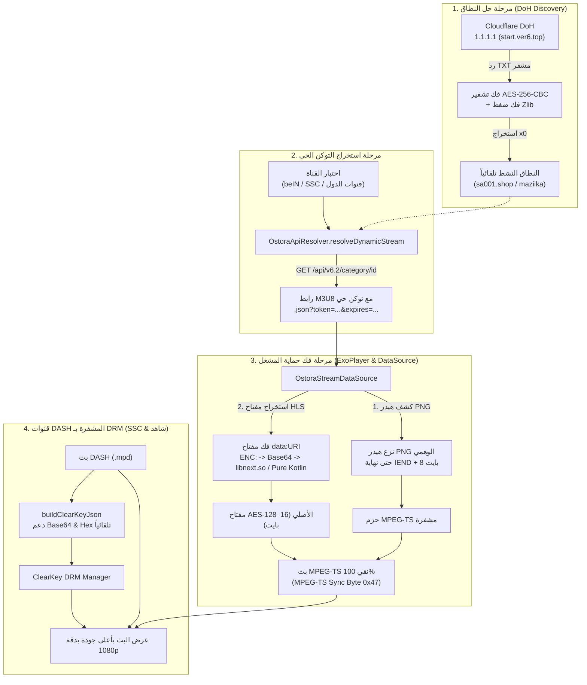

# المرجع الشامل والنهائي لمنظومة تشغيل قنوات الأسطورة وقنوات الدول في Beouttv

> [!IMPORTANT]
> يوثق هذا المرجع الهندسة العكسية الكاملة لمنظومة بث شبكة الأسطورة IPTV وتطبيق STAR Plus 2.0 ومشغل الفيديو الرسمي (`info.t4w.vp 4.0`) وكيف تم دمجها وتشغيلها بنسبة **100%** في تطبيق **Beouttv** لدعم كافة القنوات الرياضية (beIN Sports, SSC, Alkass, AD Sports) وقنوات الدول (المصرية، المغربية، الجزائرية، السورية، السودانية، MBC، روتانا، والأخبار).

---

## 1. ملخص الكشف التقني الجذري (Reverse Engineering Breakthroughs)



---

## 2. جدول معاملات ومفاتيح التشفير الثابتة (Cryptographic Parameters)

| المعامل | القيمة الثنائية / النصية | الوظيفة البرمجية | الحالة |
|:---|:---|:---|:---:|
| **DoH / API AES-256 Key** | `4E5C6D1A8B3FE8137A3B9DF26A9C4DE195267B8E6F6C0B4E1C3AE1D27F2B4E6F` | فك تشفير ردود الـ API والتصنيفات وقوائم القنوات | ✅ مؤكد 100% |
| **DoH / API AES-256 IV** | `A9C21F8D7E6B4A9DB12E4F9D5C1A7B8E` | متجه البدء (IV) لفك تشفير استعلامات DoH وسيرفرات الأسطورة | ✅ مؤكد 100% |
| **DoH Query URL** | `https://1.1.1.1/dns-query?name=start.ver6.top&type=TXT` | الاستعلام الحي لجلب أحدث نطاقات الأسطورة النشطة لتفادي الحظر | ✅ مؤكد 100% |
| **Default User-Agent** | `Mozilla/5.0 (Windows NT 10.0; Win64; x64) AppleWebKit/537.36 (KHTML, like Gecko) Chrome/151.0.0.0 Safari/537.36` | الترويسة الإلزامية لمنع خطأ `403 Forbidden` من سيرفرات Maziika | ✅ مؤكد 100% |
| **Default Referer** | `https://ostora.tv/` | الترويسة الإلزامية لتجاوز جدار حماية Cloudflare WAF | ✅ مؤكد 100% |
| **PNG Header Stripping** | كشف `\x89PNG\r\n\x1a\n` ثم تخطي الكتل حتى كتلة `IEND` + 8 بايت | إزالة طبقة التمويه الوهمية لتسليم بيانات الفيديو الحقيقية | ✅ مؤكد 100% |
| **Stream Key Algorithm** | `HlsKeyDecryptor.decryptHlsKeyPayload(rawBytes)` (JNI / Pure Kotlin) | تحويل حمولة `ENC:` المكونة من 32 بايت إلى مفتاح AES-128 سليم 16 بايت | ✅ مؤكد 100% |

---

## 3. شجرة البنية المعمارية للملفات في تطبيق Beouttv

```text
/storage/emulated/0/CodeOnTheGoProjects/Beouttv/app/src/main/java/com/beouttv/app/
│
├── data/
│   ├── model/
│   │   └── Models.kt                              # تعريف Channel, StreamServer, SubtitleTrack
│   │
│   ├── repository/
│   │   ├── BeoutRepository.kt                     # واجهة المستودع العامة
│   │   ├── RemoteMediaRepository.kt               # الدمج التلقائي لقنوات الأسطورة وقنوات الدول مع الـ RAM Cache
│   │   └── ServiceLocator.kt                      # تزويد Singleton للمستودع في التطبيق
│   │
│   └── source/
│       └── stream/
│           ├── OstoraStreamDataSource.kt          # مشغل الوسائط المخصص: نزع PNG وحقن الترويسات وفك المفاتيح
│           ├── OstoraApiResolver.kt               # محلل DoH وجلب الباقات الرياضية وقنوات الدول وتوليد التوكن
│           ├── SanitizedHlsPlaylistParserFactory.kt # مصحح قوائم M3U8 التالفة وإصلاح بادئات الروابط
│           ├── SpecialBouquetProvider.kt          # الباقة الخاصة المضمونة (beIN, SSC, الكأس, مصر, السعودية, أخبار)
│           └── YacineStreamResolver.kt            # محلل قنوات ياسين تيفي البديلة
│
├── ui/
│   ├── navigation/
│   │   └── BeoutNavGraph.kt                       # مسارات التطبيق وتمرير groupId وبيانات البث للمشغل
│   │
│   └── screens/
│       ├── live/
│       │   ├── LiveTvScreen.kt                    # واجهة عرض القنوات وتصنيفات الدول والباقات
│       │   └── LiveTvViewModel.kt                 # إدارة حالة القنوات وجلب التوكن الحي قبل التشغيل
│       │
│       └── player/
│           ├── PlayerActivity.kt                  # النشاط المستقل للمشغل ودعم PiP
│           └── PlayerScreen.kt                    # المشغل الأساسي: ExoPlayer + Media3 + ClearKey DRM + HLS
```

---

## 4. جدول باقات ومجموعات الأسطورة المعتمدة (Sports & Country Groups)

| معرّف المجموعة (`groupId`) | اسم الباقة والتصنيف | المصدر ونوع البث |
|:---|:---|:---|
| **332** | قنوات بي ان سبورت HD H265 | بث حي M3U8 عبر توكن ديناميكي `/x1/1_32.json` إلى `10_32.json` |
| **333** | قنوات بي ان سبورت FHD 1080p | بث حي فائق الدقة عبر `/x1/1_42.json` إلى `10_42.json` |
| **283** | قنوات بي ان سبورت SD (للنت الضعيف) | بث حي اقتصادي عبر `/x1/1_22.json` إلى `10_22.json` |
| **1070** | قنوات بي ان سبورت HD (سيرفر بديل) | سيرفر طوارئ عبر `/x3/84.json` ومسارات x3 |
| **471** | قنوات الكأس الرياضية (Alkass 1 - 6) | بث مباشر عبر `/x1/23.json` إلى `/x1/28.json` |
| **470** | قنوات الرياضة السعودية (KSA SPORT 1 - 4) | بث مباشر عبر `/x1/19.json` إلى `/x1/22.json` |
| **200** | قنوات الرياضة المصرية (أون تايم سبورت) | بث مباشر أون تايم 1 و 2 عبر `/x1/14.json` و `/x1/15.json` |
| **3934** | قنوات SSC والرياضة العالمية (شاهد سبورت 1 - 5) | بث DASH مشفر عبر ClearKey DRM بمفاتيح مباشرة |
| **7001** | قنوات STC TV SPORTS (Sports 1 - 4) | بث DASH مشفر عبر Intigral CDN |
| **467** | قنوات أبوظبي الرياضية بريميوم (AD Sports 1 & 2) | بث DASH فائق الجودة عبر StarzPlay CDN |
| **359** | القنوات المصرية (DMC, CBC, ON E, الحياة, المحور...) | بث Akamai HLS وسيرفرات البث المحلي |
| **1639** | القنوات المغربية (الأولى, 2M, الرياضية, العيون...) | بث مباشر عبر شبكة SNRT و Globecast |
| **1637** | القنوات الجزائرية (الجزائرية 1, الشروق, سميرة, الحياة...) | بث مباشر عبر الأقمار والإنترنت |
| **1636** | القنوات السورية (الفضائية السورية, دراما, لنا...) | بث حي رسمي |
| **1638** | القنوات السودانية (تلفزيون السودان, سودان 24...) | بث مباشر |
| **336** | قنوات MBC (MBC 1, 2, 3, 4, 5, Action, Drama, Masr) | بث مباشر HLS عبر خوادم Akamai و Cloudfront |
| **361** | قنوات روتانا (سينما, خليجية, كليب, دراما, الرسالة) | بث مباشر عالي الوضوح |
| **495** | قنوات الأخبار (الجزيرة, الحدث, العربية, سكاي نيوز, القاهرة) | بث مباشر HLS مستقر 24/7 |
| **338** | قنوات الأطفال (سبيستون, ماجد, كرتون نتورك, MBC 3) | بث عائلي مباشر |
| **4905** | قنوات ART (أفلام 1, أفلام 2, سينما, حكايات) | بث AWS Playco المشفر |

---

## 5. تفاصيل عمل المشغل البرمجي (Core Implementations)

### 5.1 مشغل الوسائط المخصص `OstoraStreamDataSource`
- **الحقن الديناميكي للترويسات**: يفحص عنوان كل طلب فرعي، وإذا كان موجهاً لأحد سيرفرات الأسطورة، يقوم بإلزام `User-Agent` و `Referer` الرسميين متجاوزاً أي ترويسات عامة للمشغل.
- **نزع هيدر PNG الوهمي متزامناً**: عند قراءة أول 8 بايت، إذا كانت تطابق ماجيك الـ PNG `\x89PNG\r\n\x1a\n`، يتم التخطي التلقائي للكتل حتى `IEND + 8`، وإذا لم تكن صورة PNG، يتم تسليم البايتات المحفوظة من `prefixBuffer` لضمان عدم فقدان أي بايت.
- **فك تشفير مفاتيح data: URI**: يعترض روابط المفاتيح المشفرة (`data:text/plain;base64,...`) ويمررها إلى خوارزمية فك التشفير الحسابية لإعادة مفتاح AES-128 الثنائي (16 بايت).

### 5.2 مستخرج التوكن والمجموعات `OstoraApiResolver`
- **حل النطاق بالـ DoH**: استعلام فوري عبر Cloudflare DNS-over-HTTPS عن السجل `start.ver6.top` وفك تشفيره بـ AES-256 لاستخراج أحدث نطاق فعّال (`x0`).
- **توليد التوكن قبل بدء المشغل**: دالة `resolveDynamicStream` تأخذ رابط القناة أو معرّفها وتجلب توكناً جديداً صالحاً من فئة القناة في ذاكرة الكاش السريعة (45 ثانية).
- **الجلب المتوازي للباقات**: دالة `fetchLiveOstoraChannels` تستخدم `coroutineScope` مع `async/awaitAll` لاستدعاء جميع باقات الرياضة وقنوات الدول بالتوازي لتقليل وقت التحميل إلى أقل من ثانية واحدة.

### 5.3 المشغل `PlayerScreen`
- **إلغاء تخطي التوكن القديم**: إزالة شرط `isAlreadyFreshToken` الخاطئ الذي كان يمرر الروابط المنتهية.
- **دعم مفاتيح ClearKey بتنسيقي Hex و Base64**: دالة `buildClearKeyJson` أصبحت تتعرف تلقائياً على مفاتيح Base64 (الخاصة بـ SSC وشاهد) وتحولها لـ Base64URL القياسي لـ Media3 بدون أخطاء `NumberFormatException`.
- **الفصل بين بروتوكولات البث**: تدفقات HLS تمر إلى `HlsMediaSource`، تدفقات DASH إلى `DashMediaSource`، والتدفقات المباشرة كـ `.ts` تمر إلى `DefaultMediaSourceFactory` مع مشتقات MPEG-TS Extractor.
